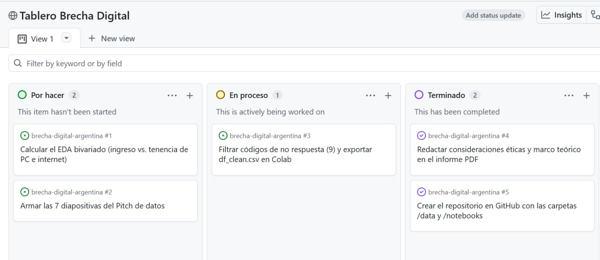

# Diagnóstico de la Brecha Digital e Inclusión Tecnológica en Argentina

## Sobre mí

**Rita Josefina Juan Briones** - Consultora Analista de Datos (en formación)

*Datos claros para decisiones públicas más justas.*

Estudio la carrera de Técnico Superior en Ciencia de Datos e Inteligencia Artificial. Me interesa usar los datos para entender problemas sociales y explicarlos de forma simple, para que sirvan a quienes tienen que tomar decisiones.

### Qué ofrezco

En este proyecto trabajo como consultora de una organización gubernamental de desarrollo social y tecnología. Mi propuesta es un diagnóstico de la **brecha digital en Argentina**: ver qué hogares tienen computadora e internet fija y cómo influyen el ingreso, la educación y la región. El objetivo es que los resultados ayuden a pensar políticas de inclusión tecnológica.

### Por qué confiar en este trabajo

Un diagnóstico sobre hogares solo sirve si se puede confiar en cómo se trataron los datos y en cómo se usan los resultados. Por eso explico acá cuáles son mis compromisos.

**Datos anonimizados**

- **Qué significa.** Las bases de microdatos de la EPH del INDEC no tienen nombres, DNI, domicilios ni teléfonos. Cada hogar se identifica solo con un código (CODUSU), que no permite saber quién es. Esto responde al secreto estadístico (Ley 17.622) y a la protección de datos personales (Ley 25.326).
- **Por qué importa.** Aunque no haya nombres, si se combinan muchas variables (región, ingreso, nivel educativo, cantidad de integrantes) se podría llegar a reconocer a un hogar, sobre todo en grupos muy chicos. Por eso la anonimización no alcanza por sí sola: también hay que cuidar cómo se presentan los resultados.
- No intento identificar a ningún hogar ni cruzo la base con otras fuentes.
- Muestro solo resultados agregados (porcentajes, promedios, tablas por categoría) y no publico grupos con muy pocos casos.
- Uso los datos únicamente para este proyecto.
- El archivo original queda sin modificar en la carpeta /data. La limpieza se hace sobre una copia que se guarda aparte.
- En el repositorio público no hay ningún dato personal: solo la base anonimizada y las referencias a la fuente.
- **Base utilizada:** microdatos con estructura de la EPH (INDEC), provistos por la cátedra con fines académicos.

**Uso responsable de los resultados**

- **Para qué se usan.** Para mostrar desigualdades y ayudar a pensar políticas de inclusión, nunca para estigmatizar a personas, hogares ni regiones.
- **Hablo de grupos, no de personas.** Si en una región el acceso es más bajo en promedio, eso no significa que todos los hogares de esa región estén igual.
- **No culpo a las personas.** No tener computadora o internet se explica por condiciones económicas y de infraestructura, no por falta de interés o de esfuerzo.
- **No se usan para excluir.** Los resultados sirven para ampliar el acceso, nunca para negar beneficios a nadie.
- **Digo qué límites tiene el análisis.** Los datos son de un solo momento (corte transversal): permiten ver asociaciones, pero no demostrar causas. Además, solo se mide el acceso a computadora e internet fija, no las habilidades digitales ni el uso que se hace de ellas.
- **Explico mis decisiones.** Cada decisión de limpieza (datos faltantes, respuestas "sin respuesta") queda escrita y justificada.

**Todo se puede repetir**

- El análisis está hecho en Python, en notebooks ordenados y comentados que se ejecutan en Google Colab. Cualquier persona puede correrlos y llegar a los mismos resultados.

### Alcance del servicio

**Qué incluye:**
- Limpieza y preparación de los datos (datos faltantes, respuestas "sin respuesta", recodificación).
- Estadística descriptiva (media, mediana, desvío, percentiles) e histogramas.
- Análisis de relaciones entre variables (tablas de contingencia y correlaciones).
- Informe técnico en PDF con conclusiones y recomendaciones de política pública.
- Presentación oral de 8 minutos con un máximo de 7 diapositivas.

**Qué no incluye:**
- Modelos predictivos ni machine learning.
- Afirmaciones sobre causalidad: los datos permiten ver asociaciones, no demostrar causas.
- Relevamiento de datos nuevos.
- Evaluación de la eficiencia de programas o inversiones concretas.

### Cómo comunico los resultados

- Uso un lenguaje claro y sin tecnicismos innecesarios.
- Cada gráfico tiene un título y una frase que explica qué muestra.
- Cada hallazgo viene acompañado de una recomendación concreta.
- La presentación final está pensada para la toma de decisiones: primero lo más importante y después el detalle.

### Herramientas

Python, pandas, numpy, matplotlib, seaborn, scipy, Google Colab y GitHub.

### Estructura del repositorio

- `data/` - bases de datos: `eph_tecnologia_microdatos.csv` (base original, 1.000 hogares) y `df_clean.csv` (base limpia, 937 hogares).
- `notebooks/` - cuadernos de Google Colab con el análisis completo, comentados paso a paso.
- `README.md` - esta presentación.

### Cómo ejecutar el análisis

No hace falta instalar nada: los cuadernos se ejecutan en **Google Colab**, que ya trae las librerías que se usan (pandas, numpy, matplotlib, seaborn y scipy).

1. Entrar a [colab.research.google.com](https://colab.research.google.com) con una cuenta de Google.
2. Abrir el cuaderno: **Archivo > Subir cuaderno** (se descarga el `.ipynb` desde la carpeta `notebooks/`) o **Archivo > Abrir cuaderno > GitHub** y pegar la dirección de este repositorio.
3. Subir a Colab el archivo de datos que necesite el cuaderno (ícono de carpeta a la izquierda > subir archivo).
4. Ejecutar las celdas **en orden** (botón de play o Shift + Enter).

Orden de los cuadernos:

| Orden | Cuaderno | Qué hace | Archivo de datos que usa |
|---|---|---|---|
| 1 | `Clase1_Exploracion_Colab.ipynb` | Explora la base: dimensiones, tipos de dato, datos faltantes y códigos de no respuesta | `eph_tecnologia_microdatos.csv` |
| 2 | `Estadisticas_e_Histogramas_Colab.ipynb` | Estadísticas descriptivas e histogramas de la base original | `eph_tecnologia_microdatos.csv` |
| 3 | `Limpieza_de_datos_Colab.ipynb` | Limpia y recodifica la base y genera `df_clean.csv` | `eph_tecnologia_microdatos.csv` |
| 4 | `Analisis_bivariado_Colab.ipynb` | Estadísticas de la base limpia, cruces de variables y prueba de las tres hipótesis | `df_clean.csv` |

Para ejecutarlos en una computadora propia: `pip install pandas numpy matplotlib seaborn scipy jupyter`.

### Diccionario de variables

**Base original** (`eph_tecnologia_microdatos.csv`):

| Variable | Descripción | Tipo | Valores |
|---|---|---|---|
| `CODUSU` | Identificador anónimo del hogar | Texto | HOG_EPH_2026_0001 ... |
| `REGION` | Región geográfica | Categórica | 1 GBA, 40 NOA, 41 NEA, 42 Cuyo, 43 Pampeana, 44 Patagonia |
| `IX_TOT` | Cantidad de integrantes del hogar | Numérica | Personas |
| `NIVEL_ED` | Nivel educativo del jefe/a de hogar | Categórica ordenada | 1 Primaria incompleta, 2 Primaria completa, 3 Secundaria incompleta, 4 Secundaria completa, 5 Superior/Universitario completo, 9 Sin respuesta |
| `ITF` | Ingreso total familiar | Numérica | Pesos |
| `DECIFR` | Decil de ingreso familiar | Categórica ordenada | 1 (más bajo) a 10 (más alto) |
| `IV12_3` | ¿El hogar tiene computadora? | Categórica | 1 Sí, 2 No, 9 Sin respuesta |
| `II7` | ¿El hogar tiene internet fija? | Categórica | 1 Sí, 2 No, 9 Sin respuesta |

**Variables creadas en la limpieza** (`df_clean.csv`):

| Variable | Descripción | Valores |
|---|---|---|
| `REGION_NOM` | Nombre de la región | GBA, NOA, NEA, Cuyo, Pampeana, Patagonia |
| `NIVEL_ED_NOM` | Nombre del nivel educativo | Primaria incompleta ... Superior/Univ. completo |
| `GRUPO_INGRESO` | Grupo de ingreso según el decil | Bajo (deciles 1-3), Medio (4-7), Alto (8-10) |
| `TIENE_PC` | Tiene computadora | 1 Sí, 0 No |
| `TIENE_INTERNET` | Tiene internet fija | 1 Sí, 0 No |

En `df_clean.csv` los códigos 9 pasaron a ser datos faltantes y se eliminaron los 63 hogares sin dato de computadora o internet. El ingreso (`ITF`) y el nivel educativo (`NIVEL_ED`) conservan algunos datos faltantes (50 y 16) que no se imputaron.

### Síntesis de hallazgos

El 63,6 % de los hogares analizados tiene computadora y el 73,4 % tiene internet fija. Se pusieron a prueba tres hipótesis:

| Hipótesis | Resultado | Evidencia |
|---|---|---|
| **H1:** a mayor nivel educativo, mayor acceso | **Se confirma** | Con primaria incompleta tiene computadora el 30 % de los hogares; con estudios superiores, el 92 % (p < 0,001) |
| **H2:** a mayor ingreso, mayor acceso | **Se confirma** | Brecha entre el decil 10 y el decil 1: 54 puntos porcentuales en computadora y 37 en internet fija (p < 0,001) |
| **H3:** a igual ingreso, NOA y NEA tienen menos internet fija que GBA | **Se rechaza** | El acceso a internet fija es de 72 % a 76 % en todas las regiones; las diferencias a igual ingreso no son significativas (p > 0,05) |

**Principales conclusiones:**

- La brecha digital se asocia, sobre todo, con el **ingreso** y el **nivel educativo**; en estos datos la región no la explica.
- El **equipamiento** (computadoras) es más desigual que la conexión a internet.
- Recomendación: focalizar las políticas de inclusión en los hogares de menores ingresos y menor nivel educativo, priorizando el acceso a computadoras.

**Limitaciones:** los datos son de un solo momento y permiten ver asociaciones, no causas; solo miden el acceso material (no las habilidades digitales); y la base fue provista por la cátedra con fines académicos, por lo que los resultados no son estadísticas oficiales del INDEC. El detalle completo está en el informe técnico (PDF).

### Organización del proyecto (tablero Kanban)

El avance del proyecto se organiza con un tablero Kanban en GitHub Projects, con las columnas **Por hacer**, **En proceso** y **Terminado**.

[Ver tablero del proyecto](https://github.com/users/josefijuan-web/projects/1/views/1)

### Contacto

- LinkedIn: [linkedin.com/in/josefina-juan-briones-b6102740](https://www.linkedin.com/in/josefina-juan-briones-b6102740/)
- Correo electrónico: josefijuan@gmail.com
